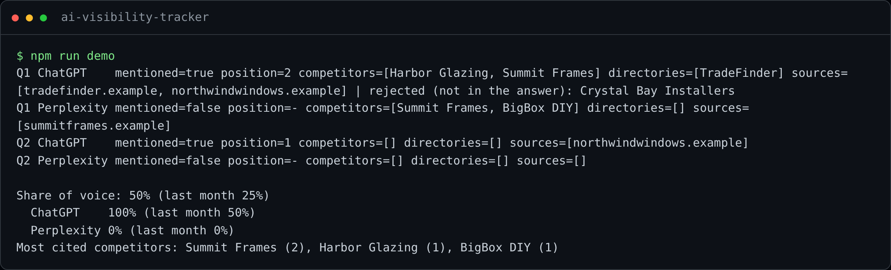

# AI Visibility Tracker

**Know whether ChatGPT and Google's AI recommend your business, or your competitor, every month,
without anyone asking 156 questions by hand.**

Customers increasingly ask an AI assistant *"which company should I hire for X in my city?"*
instead of searching. If the answer names a competitor, you never get the call, and classic SEO
tools do not see it. This tracker asks the questions your customers ask, across the AI assistants
they use, and turns the answers into a monthly share-of-voice report.



## Results in production

Running in production since autumn 2026 for a local home-improvement business in Barcelona and Tarragona:

| | |
|---|---|
| **Coverage** | 26 customer questions × 6 AI surfaces = **156 answers a month** |
| **Reliability** | November 2026 round: **156 of 156** answers captured and valid |
| **Time** | About **13 hours a month** of manual asking, copying and tallying replaced by an unattended job; reading the report takes 15 minutes *(estimate: 5 minutes per answer done by hand)* |
| **Output** | One row per answer in Notion, plus a monthly report with change against the previous month |

## Features

- **Six AI surfaces:** ChatGPT, Gemini, Perplexity, Claude, Google AI Overviews and Google AI Mode,
  in temporary or incognito mode so chat history does not bias the answers.
- **Questions by intent:** buying intent ("who should I hire"), informational ("how much does it
  cost") and differentiators (what only you offer), so you see where you win and where you are
  invisible.
- **Brand, position and competitors:** whether you are mentioned, in which position, which
  competitors and directories appear, and which websites the AI cites as sources.
- **No invented data:** a local AI model reads each answer, but a business is only counted if it
  appears word for word in the answer. Positions and percentages are computed by code.
- **Evidence kept:** every answer is saved as text, links and a screenshot before analysis, so any
  month can be re-scored later.
- **Comparable month to month:** questions keep permanent IDs; seasonal questions can be retired
  without breaking the history.
- **Honest coverage:** captchas, usage limits and login walls are recorded as such, never as
  "not mentioned".
- **Low maintenance:** each site's page structure lives in a config file, so a redesign is a
  config change, not new code.

## Quick start

The public module (answer analysis and share-of-voice report) runs on fictional data with no
dependencies and no credentials.

**With Docker**

```bash
docker compose run --rm demo    # analyze fictional answers and print the report
docker compose run --rm test    # run the test suite
```

**With Node.js 20+**

```bash
npm run demo
npm test
```

## How it works


## Tech stack

Node.js, Playwright, Ollama with Qwen 2.5 14B (runs locally, no data sent to AI APIs for
analysis), Notion API, Windows Task Scheduler, Docker for the demo.

## About this repo

A public, sanitized view of a private production system. `src/analyzer.mjs` is the production
analysis logic, translated to English; browser automation, real questions, competitors and
credentials stay private. Built by [Miguel Morales García](https://miguelmoralesgarcia.es): I
designed the system and its rules, and wrote the code with AI assistants, choosing a different
one for each part of the job. More projects: [automation-portfolio](https://github.com/miguelmoga2002-alt/automation-portfolio).

## Want this for your business?

I set up this kind of tracking and reporting for businesses that depend on being recommended.
Contact me through [miguelmoralesgarcia.es](https://miguelmoralesgarcia.es) or LinkedIn.

## License

MIT
